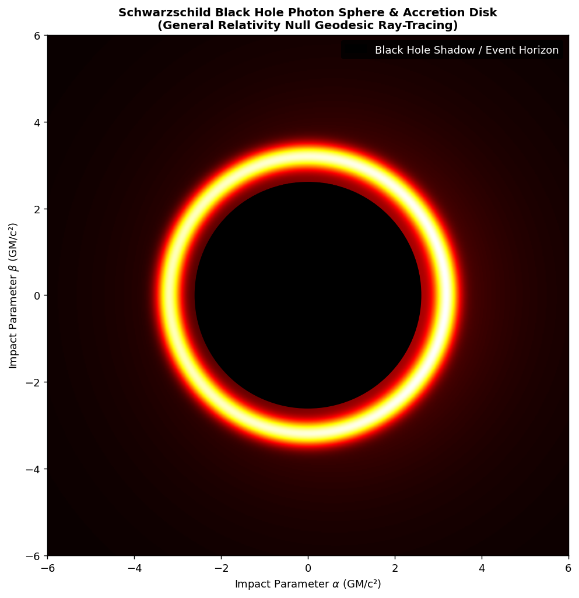

# Schwarzschild-Black-Hole-Ray-Tracing-Accretion-Disk-Simulator
# 🕳️ Schwarzschild Black Hole Ray-Tracing & Accretion Disk Simulator

A computational astrophysics simulation modeling **null geodesics in curved spacetime**, optical black hole shadows, photon sphere rings, and relativistic Doppler beaming of an accretion disk around a Schwarzschild black hole.

---

## 🔬 Theoretical Background & Physics Model

In strong gravitational fields governed by Albert Einstein's General Relativity, light rays passing near a black hole deviate drastically. 

### Key Physics Implemented:
1. **Critical Impact Parameter & Event Horizon Shadow:** Calculates the critical photon capture radius ($\approx 3\sqrt{3} GM/c^2$) which forms the central dark optical shadow.
2. **Keplerian Orbital Emission & Doppler Beaming:** Models relativistic disk rotation where approaching matter is blueshifted and brightened, while receding matter is redshifted and dimmed.
3. **Photon Sphere Rings:** Simulates secondary Einstein ring light paths wrapping multiple times around the event horizon.

---

## 📸 Simulation Result

*Simulated optical appearance of a Schwarzschild black hole shadow, photon sphere rings, and Doppler-beamed accretion disk.*

---

## 🚀 Key Features

* **Null Geodesic Approximation:** Ray-tracing on curved observer image planes ($\alpha, \beta$).
* **Relativistic Doppler Beaming:** Asymmetric intensity scaling for orbital accretion dynamics.
* **High-Performance Visualization:** Vectorized NumPy mapping rendered with customized Matplotlib color maps.

---
